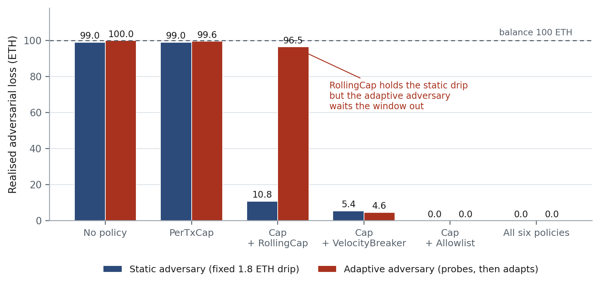
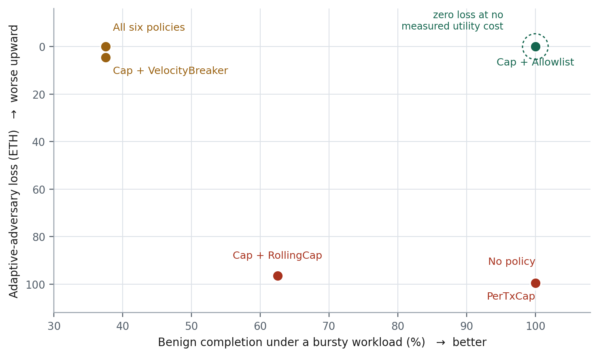
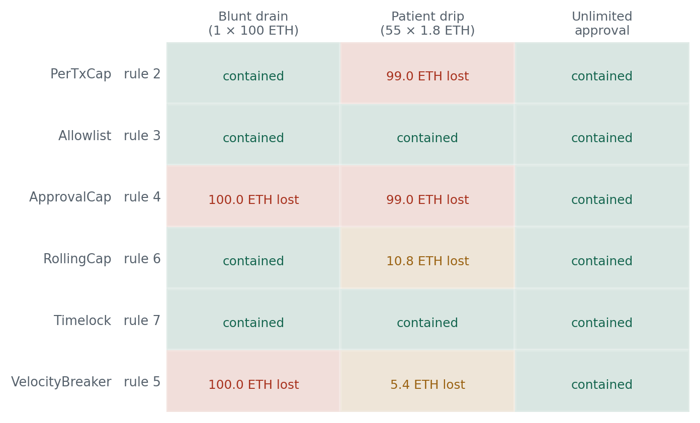
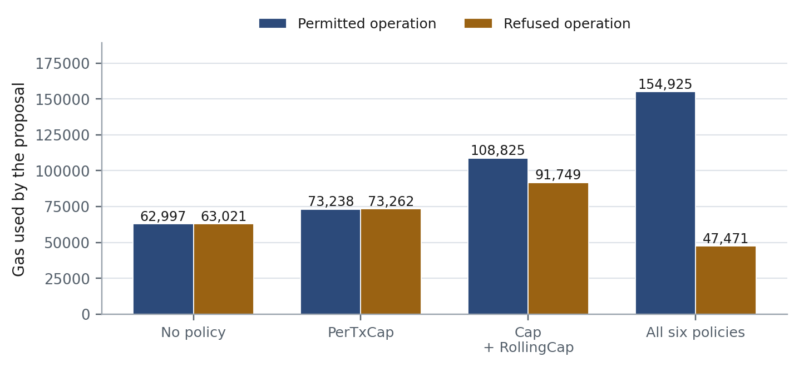
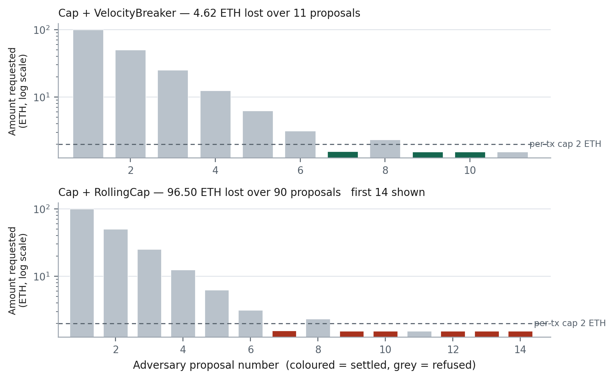

# Measured results

Generated from `results/results.json`. Wallet funded with **100 ETH**. Containment ratio C = 1 − (loss / baseline loss).

Thresholds: per-transaction cap 2 ETH; rolling cap 5 ETH per 60 min; breaker 3 ops per 60 min; timelock on anything above 1 ETH for 24 h; approval ceiling 1000 tokens.

## E1 — baseline, no policy registered

| Attack | Proposals | Settled | Loss (ETH) |
|---|---:|---:|---:|
| Blunt drain (1 × 100 ETH) | 1 | 1 | 100.00 |
| Patient drip (55 × 1.8 ETH) | 55 | 55 | 99.00 |

## E2 — each policy in isolation

Loss in ETH; containment against the E1 baseline in brackets.

| Policy | Rule | Blunt drain | Patient drip | Unlimited approval |
|---|:--:|---|---|---|
| PerTxCap | 2 | 0.00  (100.0%) | 99.00  (0.0%) | 0.00  (100.0%) |
| Allowlist | 3 | 0.00  (100.0%) | 0.00  (100.0%) | 0.00  (100.0%) |
| ApprovalCap | 4 | 100.00  (0.0%) | 99.00  (0.0%) | 0.00  (100.0%) |
| RollingCap | 6 | 0.00  (100.0%) | 10.80  (89.1%) | 0.00  (100.0%) |
| Timelock | 7 | 0.00  (100.0%) | 0.00  (100.0%) | 0.00  (100.0%) |
| VelocityBreaker | 5 | 100.00  (0.0%) | 5.40  (94.5%) | 0.00  (100.0%) |

## E3 — composition, against the static patient drip

| Configuration | Proposals | Settled | Loss (ETH) | Containment |
|---|---:|---:|---:|---:|
| Cap + RollingCap | 55 | 6 | 10.80 | 89.1% |
| Cap + VelocityBreaker | 55 | 3 | 5.40 | 94.5% |
| Cap + Allowlist | 55 | 0 | 0.00 | 100.0% |
| All six | 55 | 0 | 0.00 | 100.0% |

## E4 — adaptive adversary

The adversary probes, bisects to find the cap, waits out any window it detects, and gives up when no path to value remains.

| Configuration | Proposals | Settled | First settlement at | Loss (ETH) | Containment |
|---|---:|---:|---:|---:|---:|
| No policy | 1 | 1 | 1 | 100.00 | 0.0% |
| PerTxCap | 72 | 65 | 7 | 99.56 | 0.4% |
| Cap + RollingCap | 90 | 63 | 7 | 96.50 | 3.5% |
| Cap + VelocityBreaker | 11 | 3 | 7 | 4.62 | 95.4% |
| Cap + Allowlist | 7 | 0 | — | 0.00 | 100.0% |
| All six | 7 | 0 | — | 0.00 | 100.0% |

## E5 — benign workload, false-block cost

Eight legitimate payments. Steady: 0.5 ETH at 20-minute gaps. Burst: 0.9 ETH at 1-minute gaps.

| Configuration | Steady completion | Burst completion |
|---|---:|---:|
| No policy | 100% | 100% |
| PerTxCap | 100% | 100% |
| Allowlist | 100% | 100% |
| ApprovalCap | 100% | 100% |
| RollingCap | 100% | 62% |
| Timelock | 100% | 100% |
| VelocityBreaker | 100% | 38% |
| Cap + RollingCap | 100% | 62% |
| Cap + VelocityBreaker | 100% | 38% |
| Cap + Allowlist | 100% | 100% |
| All six | 100% | 38% |

## Gas

Gas charged to the whole `propose()` call. A refusal short-circuits at the first policy that refuses, so a refusal under a long policy list can cost less than a permit. With no policy registered nothing can refuse, so both columns measure the same permitted operation.

| Configuration | Policies | Permitted | Refused | Overhead vs none (permitted) |
|---|---:|---:|---:|---:|
| No policy | 0 | 62,997 | 63,021 | +0 |
| PerTxCap | 1 | 73,238 | 73,262 | +10,241 |
| Cap + RollingCap | 2 | 108,825 | 91,749 | +45,828 |
| All six | 6 | 154,925 | 47,471 | +91,928 |

## Security–utility frontier

| Configuration | Adaptive loss (ETH) | Burst benign completion |
|---|---:|---:|
| No policy | 100.00 | 100% |
| PerTxCap | 99.56 | 100% |
| Cap + RollingCap | 96.50 | 62% |
| Cap + VelocityBreaker | 4.62 | 38% |
| Cap + Allowlist | 0.00 | 100% |
| All six | 0.00 | 38% |

## Limitations of these numbers

These are the four places a reviewer will push, so they are stated here rather than discovered in the viva.

1. **The Allowlist result is a property of the threat model, not a general win.** The adversary in this harness has one destination, which is not on the list, so the allowlist refuses everything and the adversary gives up after 7 probes. An attacker who redirects value to a *listed* payee — a compromised supplier, or a contract the wallet legitimately trades with — walks straight through it. The 100% figure measures destination novelty, not containment.
2. **The Timelock result is an artefact of the measurement horizon.** Timelock defers rather than refuses, and the harness never runs past the 24 h delay in the attack arms. Its 0.00 ETH is 'nothing settled yet', not 'nothing will settle'. Its real contribution is review time, which this harness does not model because it has no reviewer in it.
3. **The adaptive adversary is one strategy, not a bound.** It probes, bisects, waits out windows and drips. It does not split value across destinations, batch through a contract call, or use token transfers to move value. Loss figures are lower bounds on what a better adversary extracts.
4. **Gas is measured on a single-contract path, not through an ERC-4337 EntryPoint.** The stage-1 rules would run inside `validateUserOp` under the ERC-7562 restrictions; the stage-2 rules could not, which is the whole reason for the split. These numbers show relative policy cost, not bundler-accepted validation gas.

### Figures

*Loss under a static and an adaptive adversary.*

*Security–utility frontier.*

*Which rule contains which attack.*

*Gas cost of policy evaluation.*

*Adaptive adversary probe sequence.*

